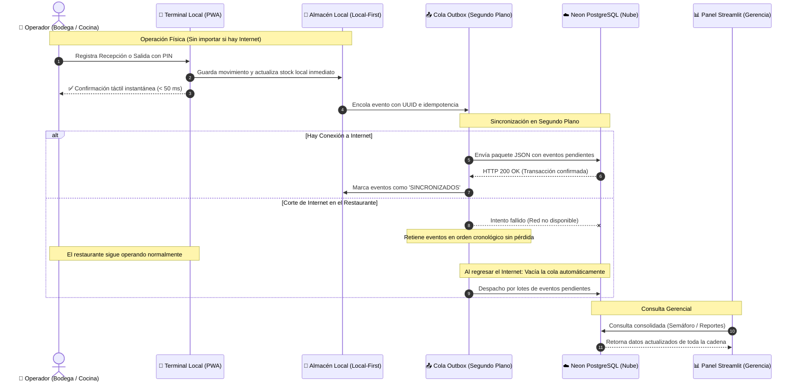

# 🏛️ Arquitectura Híbrida y Flujo Operativo Desacoplado
## Plataforma Gastronómica Mamá Qocha (v2.4 Enterprise)

> **Principio de Diseño:**  
> **"La cocina y la bodega nunca se detienen por falta de internet; la gerencia nunca sufre caídas por saturación de usuarios."**

---

## 🧭 1. Resumen Ejecutivo de la Arquitectura

Para garantizar la máxima disponibilidad, bajo consumo de recursos y total continuidad operativa, la plataforma se divide en **dos capas completamente independientes**:

```mermaid
flowchart TD
    subgraph CAPA_GERENCIAL ["☁️ CAPA GERENCIAL (Nube Central)"]
        SC["📊 Streamlit Cloud<br>mamaqocha.streamlit.app"]
        NEON[("🐘 Neon PostgreSQL<br>(Base Central Oficial)")]
        SC <-->|Lectura consolidada<br>Pool de conexiones| NEON
    end

    subgraph CAPA_SUCURSAL ["🏢 CAPA OPERATIVA (Cada Restaurante)"]
        PWA["📱 Terminal Operativa (PWA)<br>Cocina, Bodega & Mermas"]
        LOCAL_DB[("💾 Caché Local / IndexedDB<br>Almacenamiento Local-First")]
        WORKER["⚙️ Worker Asíncrono<br>(Segundo Plano)"]
        
        PWA <-->|Operación inmediata con PIN<br>Latencia < 10ms| LOCAL_DB
        LOCAL_DB -->|Eventos en cola (Outbox)| WORKER
    end

    WORKER -.->|Subida en segundo plano<br>(Cuando hay Internet)| NEON

    classDef cloud fill:#0284c7,stroke:#0369a1,stroke-width:2px,color:#fff;
    classDef local fill:#16a34a,stroke:#15803d,stroke-width:2px,color:#fff;
    classDef db fill:#0d2b45,stroke:#1e293b,stroke-width:2px,color:#fff;
    class SC cloud;
    class PWA,WORKER local;
    class NEON,LOCAL_DB db;
```

---

## 🏢 2. Separación de Roles y Entornos

### Capa A: Gerencia y Supervisión (Streamlit Cloud)
* **Destinatarios:** Dueños, Gerente General, Chef Ejecutivo Corporativo, Contabilidad y Auditores Sanitarios.
* **Acceso:** `https://mamaqocha.streamlit.app` (desde cualquier laptop, tablet o celular con internet).
* **Misión:**
  1. **Monitoreo Ejecutivo:** Visión consolidada de los 5 locales en tiempo real.
  2. **Semáforo FEFO de Riesgo:** Detección de lotes críticos y dinero en riesgo de merma.
  3. **Catálogos Maestros:** Gestión centralizada de recetas, precios de venta, lista de proveedores y personal habilitado.
  4. **Expediente Sanitario y SEREMI:** Emisión de reportes oficiales en PDF para fiscalizaciones.
* **Por qué se libera:** Al no tener a decenas de operarios haciendo clics simultáneos en Streamlit, la plataforma en la nube vuela en velocidad (< 1.5s), no consume memoria innecesaria y nunca se satura.

---

### Capa B: Operación Física en Sucursal (Local-First Autónomo)
* **Destinatarios:** Bodegueros, Chefs de Partida, Cocineros y Administradores de Turno.
* **Acceso:** Terminal táctil en pantalla de cocina/bodega (`http://localhost:8000/cocina/` o PWA instalada).
* **Misión:**
  1. **Recepción de Mercadería:** Ingreso de lotes de camiones proveedores con fecha de vencimiento y temperatura.
  2. **Salidas a Cocina (FEFO):** Descuento automático de insumos al pulsar el plato preparado.
  3. **Control de Mermas:** Registro de descartes con motivo y firma digital PIN.
  4. **Operación Offline Continua:** Si se corta la fibra óptica o el Wi-Fi del restaurante, **la pantalla sigue funcionando al 100% de su capacidad sin bloquear al personal**.

---

## 🔄 3. El Flujo de Datos Paso a Paso



---

## ⚙️ 4. Mecanismo de Sincronización en Segundo Plano

Para que las subidas a Neon sean livianas, robustas e invisibles para el operador, se aplican 4 reglas de ingeniería:

### 1. Modelo de Eventos con UUID (Idempotencia)
Cada acción genera una ficha inmutable:
```json
{
  "id_evento": "550e8400-e29b-41d4-a716-446655440000",
  "id_local": 1,
  "tipo_evento": "SALIDA_COCINA_RECETA",
  "fecha_local": "2026-11-14T18:30:00-03:00",
  "payload": {
    "id_receta": 4,
    "plato": "Ceviche Clásico",
    "porciones": 2,
    "usuario_pin": "1234"
  }
}
```
* **Ventaja:** Si la conexión es inestable y un lote se envía dos veces, Neon detecta el `id_evento` repetido y **nunca duplica el descuento ni corrompe el inventario**.

### 2. Liberación de Conexiones en Neon (Connection Pooling)
* En lugar de mantener conexiones PostgreSQL TCP abiertas de forma permanente desde 10 tablets de cocina, los eventos se suben mediante peticiones HTTP REST livianas a través de `api_sync.py`.
* Neon abre la conexión solo por los milisegundos necesarios para insertar el lote y se desconecta de inmediato, manteniéndose en modo eficiente y económico.

### 3. Recuperación Automática post-corte
* El motor asíncrono revisa la conectividad periódicamente (cada 30 a 60 segundos).
* Cuando detecta señal, vacía los eventos acumulados respetando el orden exacto en que ocurrieron los hechos físicos en la cocina.

---

## 🛡️ 5. Comparativa: Antes vs. Modelo Desacoplado

| Aspecto | Modelo Anterior (100% Streamlit Directo) | Nuevo Modelo Desacoplado (Híbrido) |
| :--- | :--- | :--- |
| **Corte de Internet en Sucursal** | Pantalla se congelaba, error de conexión, cocina parada. | **Operación 100% normal.** Se sincroniza sola al volver. |
| **Carga en Streamlit Cloud** | Alta. Todos los operarios conectados a la misma sesión. | **Mínima.** Reservada exclusivamente para Gerencia. |
| **Velocidad de Respuesta en Cocina** | 1 a 3 segundos por recarga de página Streamlit. | **Instantánea (< 50 ms)** con guardado local en milisegundos. |
| **Conexiones a Neon** | Conexiones persistentes que podían agotar el pool. | **Conexiones transitorias ultralivianas** en segundo plano. |
| **Seguridad de Datos** | Riesgo de operaciones incompletas por timeout. | **Cero pérdida de datos:** todo queda en la cola Outbox. |

---

## 📋 6. Protocolo Operativo Preventivo ante Cortes de Internet (SOP)

Para prevenir cualquier discrepancia de inventarios entre sucursales durante una caída de internet, se establece la siguiente regla operativa:

1. **Operación Física Habilitada (Sin Restricciones):**
   * **Cocina:** Sigue despachando platos y descontando FEFO normalmente en la tablet.
   * **Bodega:** Sigue recibiendo camiones de proveedores urgentes y registrando mermas en la tablet.
   * Ambos movimientos se acumulan de forma segura en la cola *Outbox* del servidor local.
2. **Operación Administrativa en Pausa Preventiva:**
   * En el Panel Central (`app.py`), el sistema detecta la desconexión y muestra una alerta visual amarilla activa:
     `📡 Alerta Preventiva: Sin conexión a Neon Cloud`.
   * **Procedimiento:** Se recomienda al administrador **no realizar cambios estructurales** (edición de fichas técnicas de recetas, modificación de precios, altas de usuarios o emisión de traspasos entre locales) hasta que el enlace a la nube se restablezca, garantizando que no se generen desfasajes con la base maestra.

---

## 📂 7. Componentes del Código en el Repositorio

* **`app.py`:** Interfaz ejecutiva Streamlit (Semáforo consolidado, auditoría, maestros y reportes SEREMI).
* **`api_sync.py`:** Micro-servicio FastAPI receptor de lotes asíncronos y bootstrap de stock.
* **`pwa_cocina/`:** Terminal táctil de despacho y recetas con soporte offline completo.
* **`db.py`:** Capa de acceso a datos a Neon PostgreSQL optimizada con pool pre-ping.
* **`MANUAL_USUARIO_MAMA_QOCHA.md`:** Manual operativo paso a paso para el personal y administradores.
